# 가즈아

<p align="center">
  <picture>
    <source media="(prefers-color-scheme: dark)" srcset="docs/readme/hero-dark.svg">
    
  </picture>
</p>

<p align="center"><b>관심종목을 한 차트에 놓고 비교하고 시험하는 주식 앱</b><br>
<a href="https://gazua.sch0718.dev/">gazua.sch0718.dev</a> · 설치·회원가입 없이 휴대폰과 PC 브라우저에서</p>

관심 있는 종목 여러 개를 한 차트에 나란히 놓고 같은 기준으로 비교해요. 내 매수·매도 규칙이나 종목을 고르는 기준이 과거에 통했는지 시험해 보고, 토스 계좌의 실제 거래가 시장보다 나았는지도 확인해요. 증권사 키가 없어도 **데모 데이터**로 모든 화면을 써 볼 수 있어요.

## 이런 걸 할 수 있어요

|                    |                                                                                                                                                       |
| ------------------ | ----------------------------------------------------------------------------------------------------------------------------------------------------- |
| 📈 **비교하기**    | 관심 그룹(최대 10종목)을 한 차트에 놓고 일·주·월·년 기간으로 봐요. 등락률, 고점 대비 하락률, 시장 대비 초과수익, 상대 거래량, 시가총액으로 비교해요. |
| 🕘 **거래 시간**   | KRX·NXT를 골라 보고, 종목마다 거래할 수 있는 시간과 단일가 구간을 차트 아래에 보여 줘요.                                                              |
| 🗂️ **그룹 만들기** | 종목을 이름·초성으로 찾아 담고, 토스 보유 종목·토스 섹터나 지표 순위로 새 그룹을 만들어요.                                                            |
| 🧪 **규칙 시험**   | 내 매수·매도 규칙을 과거 일봉에 적용해 수익률·낙폭·승률을 그냥 보유·지수·ETF와 비교해요.                                                              |
| 🔍 **기준 검증**   | 종목 고르는 조건(시세·환율·유가·수급·재무)을 과거 시점마다 적용해, 그때 골랐다면 어땠을지 확인해요.                                                   |
| 💼 **내 성과**     | 토스 계좌의 체결된 주문을 같은 날 같은 금액으로 지수·ETF를 샀을 때와 비교해요.                                                                        |

## 시작하기

1. 휴대폰이나 PC 브라우저로 **[gazua.sch0718.dev](https://gazua.sch0718.dev/)** 를 엽니다. 휴대폰에서는 브라우저의 `홈 화면에 추가`로 앱처럼 쓸 수 있어요.
2. 첫 화면에서 `데모로 둘러보기`를 누르면 가상 시세로 모든 화면을 써 볼 수 있어요.
3. 실제 시세를 보려면 `내 API로 시작`(나중에는 설정)에서 증권사(한국투자증권 또는 토스증권)를 고르고 프록시와 키를 넣어요. 준비 방법은 [증권사 연결](docs/providers.md)에 있어요.

## 간단한 사용법

- **비교하기** — 그룹을 고르고 `일`·`주`·`월`·`년`과 지표를 바꿔 봐요. 아래 순위는 `값 순`·`내 순서`로 바꿔요. → [비교 차트](docs/help/compare.md)
- **종목 담기** — `＋ 종목 추가`에서 이름·코드·초성으로 찾아 ＋로 담고, ✓를 다시 누르면 빼요. → [종목 추가](docs/help/add.md)
- **그룹 정리** — 그룹 이름 옆 ＋로 새 그룹, `⋯`(그룹 관리)에서 이름·순서를 바꾸거나 토스·조건으로 새 그룹을 만들어요. → [그룹 관리](docs/help/groups.md)
- **규칙 시험** — 시뮬레이션 › `매매 규칙`에서 새 전략을 만들고 `시뮬레이션 실행`. → [매매 규칙 시뮬레이션](docs/help/simulate.md)
- **기준 검증** — 시뮬레이션 › `선정 기준`에서 시장 데이터를 가져온 뒤 조건을 켜고 `검증 실행`. → [선정 기준 검증](docs/help/criteria.md)
- **내 성과** — 앱 바의 `내 성과`에서 벤치마크를 골라요. 실제 계좌는 공급자가 토스일 때 봐요. → [내 성과](docs/help/performance.md)

## 메뉴별 도움말

움직이는 그림으로 실제 화면 흐름을 단계별로 보여 줘요. 모아 보기는 [도움말 모음](docs/help/README.md)에 있어요.
앱에서는 앱 바의 물음표 단추나 설정 › `도움말 보기`로 볼 수 있고, 메뉴에 처음 들어가면 안내가 한 번 떠요.

| 메뉴                                            | 무엇을 하나요                                                   |
| ----------------------------------------------- | --------------------------------------------------------------- |
| [비교 차트](docs/help/compare.md)               | 그룹 고르기, 기간·지표 바꾸기, 거래소 전환, 순위 보기           |
| [종목 추가](docs/help/add.md)                   | 이름·코드·초성 검색, ＋로 담기, ✓로 빼기                        |
| [그룹 관리](docs/help/groups.md)                | 새 그룹, 이름·순서, 토스에서 가져오기, 조건으로 골라 새 그룹    |
| [매매 규칙 시뮬레이션](docs/help/simulate.md)   | 매수·매도 규칙, 실행 결과, 자산 곡선, 거래 내역                 |
| [선정 기준 검증](docs/help/criteria.md)         | 시장 데이터 가져오기, 조건 켜기, 재선정, 지수·ETF와 결과 비교   |
| [내 성과](docs/help/performance.md)             | 벤치마크, IRR·초과수익, 평가금액 곡선, 종목별 기여도·수량 대조  |
| [설정과 연결](docs/help/settings.md)            | 공급자 고르기, 프록시·키, 연결 진단, 키 잠그기, 표시·데이터     |

## 내 데이터는 어디에 있나요?

- 기본은 로그인도 서버 저장도 없어요. 그룹·설정·API 키는 **지금 쓰는 브라우저에만**(localStorage·IndexedDB) 저장돼요.
- 동기화를 설정한 빌드에서는 설정 › 동기화·공유에서 본인 Google 계정으로 로그인해 그룹·전략·선정 기준·묶음·분석 설정을 기기끼리 맞출 수 있어요. 키·계좌·주문 내역·성과는 올리지 않고, 올린 데이터는 암호화하지 않은 채 서버에 저장돼요. 읽기 전용 공유 링크는 7일(최대 30일) 뒤 만료되고 언제든 철회할 수 있어요. [동기화 Worker](sync-worker/README.md)
- 다른 기기로 옮길 때는 설정 › 데이터 › `내보내기`로 받은 파일을 그 기기에서 `가져오기`해요. 키는 빼는 게 기본이에요.
- **토스 키는 주문 권한을 가져요.** 설정 › `키를 암호로 잠그기`를 켜 두고, 공용 기기에서는 다 쓴 뒤 `이 기기에서 키 삭제`를 눌러요.
- 시세는 내가 띄운 프록시를 거쳐 증권사에서 받아요. 프록시는 조회 경로만 전달하고 주문 경로는 막아요. 자세한 내용은 [증권사 연결](docs/providers.md#보안-주의)에 있어요.

## 릴리스

버전별 변경 내역은 [GitHub 릴리스](https://github.com/sch0718/gazua/releases)에 있어요. 앱은 `main`에 병합될 때마다 배포되고, 릴리스는 기능 묶음이 끝날 때 붙이는 이정표예요.

| 버전                                                            | 날짜       | 내용                                                                         |
| --------------------------------------------------------------- | ---------- | ---------------------------------------------------------------------------- |
| [v0.7.0](https://github.com/sch0718/gazua/releases/tag/v0.7.0) | 2026-10-25 | README 소개 그림, 메뉴별 도움말(움직이는 그림), 앱 도움말과 메뉴 처음 안내   |
| [v0.6.0](https://github.com/sch0718/gazua/releases/tag/v0.6.0) | 2026-10-24 | 내 성과(토스 계좌 체결을 지수·ETF와 비교)                                    |
| [v0.5.0](https://github.com/sch0718/gazua/releases/tag/v0.5.0) | 2026-10-23 | 그룹 10종목, 조건으로 골라 새 그룹, 리더보드 정렬 전환, 프록시 자동 반영     |
| [v0.4.0](https://github.com/sch0718/gazua/releases/tag/v0.4.0) | 2026-10-19 | 토스 실연결(맥 프록시), 커스텀 도메인, 넓은 화면, 토스에서 그룹 가져오기     |
| [v0.3.0](https://github.com/sch0718/gazua/releases/tag/v0.3.0) | 2026-10-17 | 선정 기준 검증(시세·환율·유가·테마·수급·재무)                                |
| [v0.2.0](https://github.com/sch0718/gazua/releases/tag/v0.2.0) | 2026-10-14 | 매매 규칙 시뮬레이션                                                         |
| [v0.1.0](https://github.com/sch0718/gazua/releases/tag/v0.1.0) | 2026-10-12 | 첫 버전: 관심종목 비교 차트                                                  |

새 릴리스는 `main`의 병합 커밋에 태그를 붙여 만들어요. 버전은 새 기능 묶음이면 두 번째 자리(`0.x.0`), 수정만 있으면 세 번째 자리(`0.x.y`)를 올리고, `package.json`(앱·프록시)의 `version`도 같이 맞춰요.

```bash
gh release create v0.7.0 --target <병합 커밋> --title "v0.7.0 — <요약>" --notes-file <노트 파일>
```

## 개발자용

- [증권사 연결](docs/providers.md) — KIS·토스 준비, 프록시, 보안 주의
- [개발 문서](docs/development.md) — 시장 데이터 수집, 설치·명령, 클라우드 세션, 배포, 설계·계획 문서. 설치에는 공용 패키지(`@sch0718/*`)용 GitHub Packages 토큰(`GITHUB_PACKAGES_TOKEN`)이 필요해요
- [프록시](proxy/README.md) — Cloudflare Worker·Node 프록시 배포와 HTTP 계약
- [동기화 Worker](sync-worker/README.md) — 개인 동기화·읽기 공유 Worker, D1·Firebase Auth 준비와 배포 순서
- [실연결 점검 목록](docs/live-check.md) — 실제 키로 확인할 항목과 결과

## 후원

가즈아는 무료예요. 서버·도메인 비용을 돕고 싶다면 Ko-fi로 커피 한 잔을 보낼 수 있어요(페이지 준비 중 — 열리면 앱의 **설정 → 정보**에 **후원하기**가 생겨요). 후원해도 기능이나 혜택이 달라지지 않아요.

## 라이선스

[PolyForm Noncommercial 1.0.0](LICENSE)을 따라요. 소스는 공개하지만 OSI가 인정한 오픈소스 라이선스는 아니에요.

- **허용**: 코드 보기, 개인 용도의 사용·수정·재배포, 비영리 단체·교육·공공 기관의 사용. 개인이 자기 돈으로 하는 투자 판단에 쓰는 것도 개인 용도로 허용해요.
- **금지**: 그 밖의 상업적 이용. 예를 들어 코드를 가져가 광고를 붙여 다시 배포하거나, 회사 서비스·유료 상품에 넣는 것. 상업적으로 쓰고 싶으면 [이슈](https://github.com/sch0718/gazua/issues)로 문의해 주세요.
- **이름·로고**: '가즈아' 이름과 아이콘은 라이선스에 포함되지 않아요. 수정본을 배포할 때는 다른 이름을 써 주세요.
- **기여**: 이 저장소에 코드를 보내면 같은 라이선스로, 그리고 저작권자가 따로 줄 수 있는 라이선스로도 쓰일 수 있다는 데 동의한 것으로 봐요.
- **사용한 오픈소스와 데이터 출처**: 앱의 **설정 → 정보 → 오픈소스와 데이터 출처**에 있어요.

© 2026 신춘호
