# 보유 종목

<!-- 이 파일은 corepack pnpm build:motion으로 생성합니다. 문구는 scripts/motion/help-pages.mjs에서 고칩니다. -->

  <picture>
    <source media="(prefers-color-scheme: dark)" srcset="../../public/help/img/holdings-dark.svg">
    
  </picture>

토스 계좌의 보유와 직접 넣은 보유를 관심 종목처럼 한 차트에서 실시간으로 봐요.

## 이렇게 써요

1. **합계와 실시간 등락률** — 맨 위 합계와 차트·순위가 시세를 따라 바뀌어요
2. **계좌로 나눠 보기** — 라벨 칩을 누르면 그 계좌의 종목만 합계·차트·목록에 남아요
3. **보유 내역 보기** — 차트 아래에 계좌별 합계와 종목별 수량·평단·손익
4. **직접 추가** — `＋ 직접 추가`로 토스에 없는 종목의 수량·평단·계좌 라벨을 넣어요

## 알아 두면 좋아요

- 공급자가 토스면 계좌의 보유 종목이 저절로 들어와요. 데모 데이터에서는 가상 계좌의 보유가 `데모` 라벨로 보여요. 한국투자증권 공급자는 직접 넣은 보유만 보여요.
- 토스를 쓰거나 직접 넣은 보유가 있으면 앱을 열 때 이 화면이 먼저 열려요.
- 맨 위 줄은 코스피·코스닥 등락률이에요. 장이 열리기 전이나 쉬는 날에는 마지막 거래일 값에 날짜를 붙여 보여 줘요.
- 순위 목록의 `수익`은 평단 기준 내 수익률·수익금이에요(같은 종목이 여러 계좌에 있으면 합산). `수익금순`·`수익률순`을 누르면 보유 내역과 순위가 큰 것부터 정렬돼요. 평단을 모르는 종목은 맨 뒤예요.
- `오늘`은 직전 거래일 종가 대비 지금 평가손익이에요. 평균 매수가를 모르는 종목은 평가손익에서 빼요.
- 직접 넣은 보유는 이 기기에만 저장해요. 보유 수량·평단은 계좌 정보라 동기화·공유·내보내기에 넣지 않아요. 목록에서 직접 넣은 종목을 누르면 고치거나 지워요.
- 당겨서 새로고침하면 시세와 함께 토스 보유도 다시 받아요.
- 차트·순위·기간·지표·거래소 고르기는 `비교 차트`와 같아요. 이 화면에서 숨기거나 순서를 바꾼 것은 화면을 떠나면 처음대로 돌아가요.

---

[도움말 모음](README.md) · [README](../../README.md)
