# 내 성과

<!-- 이 파일은 corepack pnpm build:motion으로 생성합니다. 문구는 scripts/motion/help-pages.mjs에서 고칩니다. -->

  <picture>
    <source media="(prefers-color-scheme: dark)" srcset="../../public/help/img/performance-dark.svg">
    
  </picture>

토스 계좌의 체결된 주문을 같은 날 같은 금액으로 지수를 샀을 때와 비교해요.

## 이렇게 써요

1. **벤치마크 고르기** — 자동(시장 지수)·KOSPI·KOSDAQ·KODEX 200·KODEX 코스닥150
2. **IRR 비교** — 내 IRR과 벤치마크 IRR, 그 차이(초과)
3. **평가금액 + 회수액** — 내 계좌·벤치마크·넣은 돈을 한 차트에
4. **종목별 기여도** — 차이 큰 순, 수량이 다르면 `맞지 않음`

## 알아 두면 좋아요

- 실제 계좌는 공급자가 토스일 때 봐요. 데모 데이터에서는 `데모 계좌예요` 표시와 함께 가상 계좌로 둘러봐요.
- 프록시는 주문 목록 **조회**(`GET /api/v1/orders`)만 전달하고 주문 경로는 계속 막아요. 이 기능이 생기기 전에 띄운 프록시는 새 버전으로 바꿔요.
- `기간`에서 전체나 연도를 고르면 그 기간만 따로 계산해요.
- 토스 API에는 배당·입출금·입고 내역이 없고 시간외 종가 주문도 조회되지 않아요. 그래서 체결된 주문만으로 계산하고, 주문을 더한 수량이 보유 수량과 다르면 `맞지 않음`으로 알려요.
- 가상 매수는 그날 종가로 계산해요. 해외 주문은 빼요.
- 받은 주문은 이 기기의 IndexedDB에 남겨 다음에는 이어 받아요. 키 잠금 중에는 저장하지 않고, 키를 지우면 함께 지워요.

---

[도움말 모음](README.md) · [README](../../README.md)
