# 설정과 연결

<!-- 이 파일은 corepack pnpm build:motion으로 생성합니다. 문구는 scripts/motion/help-pages.mjs에서 고칩니다. -->

  <picture>
    <source media="(prefers-color-scheme: dark)" srcset="img/settings-dark.svg">
    
  </picture>

데이터 공급자를 고르고 프록시와 키를 넣어 실제 시세로 바꿔요.

## 이렇게 써요

1. **공급자 고르기** — 한국투자증권(KIS)·토스증권·데모 데이터 중에서
2. **프록시와 키 넣기** — 프록시 URL·토큰과 App Key·App Secret
3. **연결 진단** — 프록시 → CORS → 토큰 → 시세 순서로 확인해요
4. **키 잠그기** — 켜면 앱을 열 때마다 암호를 물어요

## 알아 두면 좋아요

- 증권사 키가 없어도 `데모 데이터`로 모든 화면을 써 볼 수 있어요.
- 증권사 API는 브라우저에서 바로 부를 수 없어(CORS) 작은 프록시를 거쳐요. 공급자별 준비는 [증권사 연결](../providers.md)에 있어요.
- 키와 설정은 이 브라우저에만 저장돼요. 토스 키는 주문 권한을 가지니 `키를 암호로 잠그기`를 켜 두세요. 다 쓴 공용 기기에서는 `이 기기에서 키 삭제`를 눌러요.
- `표시`에서 테마(시스템·라이트·다크)와 상승·하락 색(한국식 빨강▲ 파랑▼ / 글로벌 초록▲ 빨강▼)을 골라요.
- `데이터`에서 관심종목(그룹·설정)을 내보내고 가져오거나, 시장 데이터 파일을 가져오고, 캐시를 비워요. `프로필`로 설정 묶음을 여럿 둘 수 있어요.

---

[도움말 모음](README.md) · [README](../../README.md)
